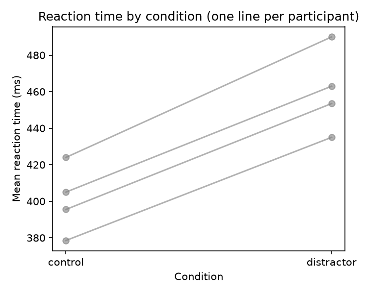

<!--
  ╔══════════════════════════════════════════════════════════════════════════╗
  ║  This README is the front page of your project. Recruiters and          ║
  ║  admissions readers often read only this page, so make it count.        ║
  ║                                                                         ║
  ║  • Replace everything in _italics_ and every <...> placeholder.         ║
  ║  • Notes like this box are hidden on GitHub. You can leave them in,     ║
  ║    or delete them when you're done.                                     ║
  ║  • Guide: ls100-guides/03_make-it-portfolio-ready.md                    ║
  ╚══════════════════════════════════════════════════════════════════════════╝
-->

# _Project title: say what you found or measured, not the assignment name_

<!-- Replace OWNER/REPO in both badge links with your GitHub username and repository name,
     e.g. jdoe/gait-dual-task-analysis. -->
[](https://github.com/OWNER/REPO/actions/workflows/reproducibility-check.yml)
[](https://codespaces.new/OWNER/REPO)

**_One sentence: what question you asked, how, and the headline result._**
<!-- Example: "Using pose estimation on 24 walking videos, I show that a cognitive dual task
     shortens stride length by 9% in young adults." -->

<!-- Your best figure goes here. Save it from a notebook into figures/, then update the path. -->


## Question and motivation

_2–4 sentences. What behavior are you studying, why does it matter, and what was your
hypothesis?_

## Data

_What data, how much of it, and how it was collected. Example: "16 trials from 4 adult
participants in a reaction-time task with and without a visual distractor."_

<!-- Be specific about privacy. Read data/raw/README.md and fill it in before making this
     repository public. -->
See [`data/raw/README.md`](data/raw/README.md) for the data source, consent, and what is (and
is not) shared in this repository.

## Approach

<!-- One line per notebook, in the order they run. Mark GPU steps. -->

| Step | Notebook | What it does |
| --- | --- | --- |
| 1 | [`01_analysis.ipynb`](01_analysis.ipynb) | _Loads raw data, computes per-participant means, plots conditions_ |
| _2_ | _`02_..._GPU.ipynb`_ | _(GPU, run in Google Colab) e.g. extracts body keypoints from video with YOLO_ |

**Methods and tools:** _e.g. Python, pandas, YOLO pose estimation, mixed-effects models (statsmodels)_

## Results

_3–5 sentences, with the key numbers (effect sizes, test statistics, sample sizes). Refer to
figures by name. Say what the result means for your question._

## Limitations and next steps

_2–3 honest sentences: sample size, measurement noise, what you'd do with more time. Showing
you understand the limits of your work is a strength._

## Reproduce this analysis

Everything except the GPU steps re-runs automatically on every change (see the badge above).

1. Click **Open in GitHub Codespaces** above. Python and all packages install automatically.
2. Open the notebooks in order, and run each with **Restart → Run All**.
3. Notebooks with `GPU` in their name run in [Google Colab](https://colab.research.google.com)
   with a GPU runtime. Their outputs are already saved in `data/processed/`, so later steps
   work without re-running them.

To run on your own computer instead: `pip install -r requirements.txt`, then open the notebooks
in Jupyter.

## Repository structure

```
├── 01_analysis.ipynb      notebooks, numbered in the order they run
├── data/
│   ├── raw/               original data (never edited), plus a data statement
│   └── processed/         data created by the notebooks
├── figures/               plots saved by the notebooks
├── requirements.txt       Python packages
├── LICENSE                how others may reuse your code
└── ls100-guides/          course how-to guides (safe to delete)
```

## About

_Your name_ · [LinkedIn](https://www.linkedin.com/in/_your-profile_) · [GitHub](https://github.com/_your-username_)

This project was completed in **LS100: Computational Behavioral Sciences** at Harvard
University ([course materials](https://github.com/Souvik-Mandal-Harvard/Computational-Behavioral-Sciences_LS100_Harvard)),
instructed by Souvik Mandal, Ph.D. The project structure is based on the
[LS100 project template](https://github.com/Souvik-Mandal-Harvard/ls100-project-template).

Code is released under the [MIT License](LICENSE).
